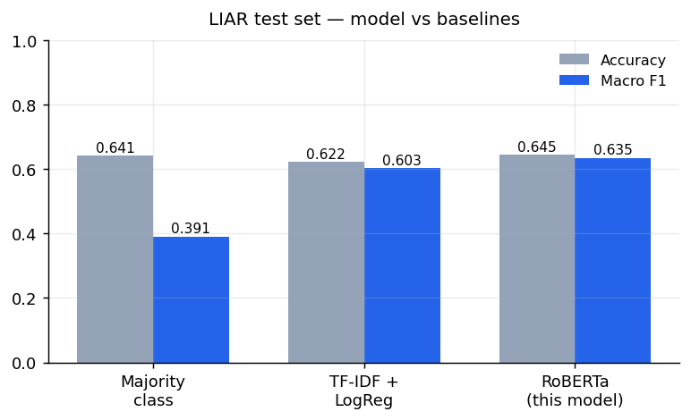
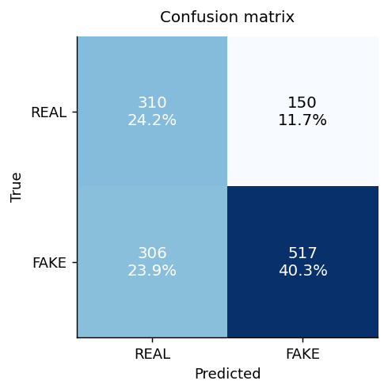
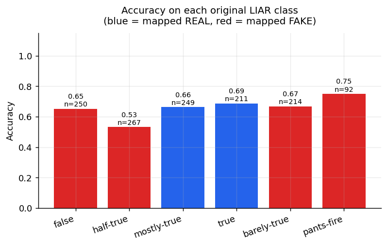
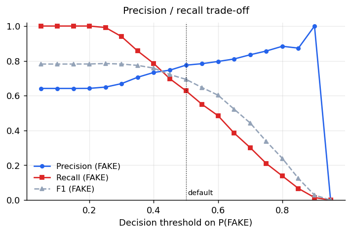
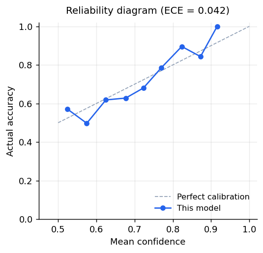

<p align="center">
  <a href="https://huggingface.co/emonHasan01/liar-roberta">
    
  </a>
  <a href="https://huggingface.co/spaces/emonHasan01/liar-roberta">
    
  </a>
  
  
</p>


<div align="center">

[Hugging Face](https://huggingface.co/emonHasan01) | [GitHub](https://github.com/Md-Emon-Hasan) | [LinkedIn](https://www.linkedin.com/in/md-emon-hasan-695483237/) | [WhatsApp](https://wa.me/8801834363533) | [Portfolio](https://emonlabs-ai.hitechparks.com/) | [Medium Blog](https://medium.com/@emon.mlengineer/fine-tuning-roberta-on-liar-everything-that-happens-after-trainer-train-cac4b8112bcd?postPublishedType=initial)

**Author:** [Md. Emon Hasan](https://huggingface.co/emonHasan01)

</div>

# liar-roberta

**A binary classifier that labels a short political statement as REAL or FAKE.**
Full fine-tune of [`roberta-base`](https://huggingface.co/roberta-base) on
[LIAR](https://huggingface.co/datasets/liar), the PolitiFact fact-check corpus.

On the LIAR test split it reaches **64.5% accuracy and 0.6351 macro-F1**, clearly ahead of
a TF-IDF + logistic regression baseline trained on the same data (0.6025 macro-F1).
Every number on this page comes from the single run that produced these weights; the raw
values are in [`results.json`](results.json).

```python
from transformers import pipeline
clf = pipeline("text-classification", model="emonHasan01/liar-roberta")
clf("The moon landing was filmed in a Hollywood studio.")
```

## Label scheme

LIAR ships six truthfulness classes, collapsed here into two:

| Binary label | LIAR classes |
|---|---|
| `REAL` (0) | true, mostly-true |
| `FAKE` (1) | false, half-true, barely-true, pants-fire |

Worth flagging: LIAR's integer label order is **not** sorted by truthfulness
(`4 = barely-true` and `5 = pants-fire` are the two least truthful, not the most).
A fair amount of published code treats them as the truthful end and inverts the whole
task. This model resolves the mapping from the dataset's label *names*, never indices.

The collapse leaves the data imbalanced — 460 REAL against 823 FAKE in the
test split — so training used class-weighted cross-entropy and the checkpoint was chosen
on macro-F1 rather than accuracy.

## Results



| | Accuracy | Macro F1 | F1 (FAKE) | Precision (FAKE) | Recall (FAKE) | ROC AUC |
|---|---|---|---|---|---|---|
| Majority class | 0.6415 | 0.3908 | — | — | — | — |
| TF-IDF + LogReg | 0.6220 | 0.6025 | 0.6905 | 0.7272 | 0.6574 | 0.6496 |
| **RoBERTa (this model)** | **0.6446** | **0.6351** | **0.6940** | **0.7751** | **0.6282** | **0.6959** |

The majority-class row is there on purpose. Accuracy alone on this dataset says very
little, since always answering FAKE already scores 0.6415.



## Where it succeeds and fails

Accuracy across the six original LIAR classes, before the binary collapse:



| LIAR class | Mapped to | n | Accuracy | Mean P(FAKE) |
|---|---|---|---|---|
| false | FAKE | 250 | 0.652 | 0.586 |
| half-true | FAKE | 267 | 0.532 | 0.534 |
| mostly-true | REAL | 249 | 0.663 | 0.456 |
| true | REAL | 211 | 0.687 | 0.449 |
| barely-true | FAKE | 214 | 0.668 | 0.594 |
| pants-fire | FAKE | 92 | 0.750 | 0.639 |

The ends of the scale are separable; the middle is not. `half-true` and `mostly-true`
differ by an editorial judgement that is largely unrecoverable from 18 words of text,
and the model's scores reflect that.

### Most confident mistakes

| LIAR class | True | Predicted | Confidence | Statement |
|---|---|---|---|---|
| true | REAL | FAKE | 0.90 | "Obama has more czars than the Romanovs." |
| true | REAL | FAKE | 0.88 | The words subhuman mongrel, which Ted Nugent called President Barack Obama, were used by the Na |
| mostly-true | REAL | FAKE | 0.88 | Obama-Nelson economic record: Job creation ... at slowest post-recession rate since Great Depre |

Of 456 errors, 150 are real statements flagged as fake and 306 are fake
statements let through.

## Choosing a threshold

P(FAKE) is exposed, so the 0.5 cutoff is a starting point rather than a verdict:



| Threshold | Precision (FAKE) | Recall (FAKE) | F1 | Share flagged |
|---|---|---|---|---|
| 0.20 | 0.642 | 1.000 | 0.782 | 99.9% |
| 0.30 | 0.669 | 0.939 | 0.782 | 90.0% |
| 0.40 | 0.733 | 0.785 | 0.758 | 68.7% |
| 0.50 | 0.775 | 0.628 | 0.694 | 52.0% |
| 0.60 | 0.796 | 0.485 | 0.603 | 39.0% |
| 0.70 | 0.835 | 0.301 | 0.443 | 23.1% |
| 0.80 | 0.884 | 0.139 | 0.239 | 10.1% |

At threshold 0.65 precision reaches 0.811, with recall falling to 0.385.

## Is the confidence meaningful?



Expected calibration error is **0.042** over 10 bins. Points below the diagonal mean
overconfidence: when the model says 0.9 it is right less often than 90% of the time.
Treat the score as a ranking signal, not as a probability of being lied to.

## Usage

```python
import torch
from transformers import AutoTokenizer, AutoModelForSequenceClassification

tok = AutoTokenizer.from_pretrained("emonHasan01/liar-roberta")
model = AutoModelForSequenceClassification.from_pretrained("emonHasan01/liar-roberta")

inputs = tok("Your statement here", return_tensors="pt", truncation=True, max_length=128)
with torch.no_grad():
    probs = model(**inputs).logits.softmax(-1)[0]
print("P(REAL)", probs[0].item(), "P(FAKE)", probs[1].item())
```

### Longer documents

The model saw statements of about 22 tokens and has a 128-token window. Feeding
a whole article truncates it. Chunk and average instead:

```python
def classify_long(text, tok, model, chunk_words=60):
    w = text.split()
    chunks = [" ".join(w[i:i+chunk_words]) for i in range(0, len(w), chunk_words)] or [text]
    enc = tok(chunks[:32], return_tensors="pt", truncation=True, padding=True, max_length=128)
    with torch.no_grad():
        p = model(**enc).logits.softmax(-1).mean(0)
    return {"REAL": p[0].item(), "FAKE": p[1].item()}
```

Results on full articles are out of distribution either way — see Limitations.

## Training

| | |
|---|---|
| Base model | `roberta-base`, 125M parameters, all trained |
| Objective | Class-weighted cross-entropy (weights 1.41, 0.78) |
| Max length | 128 tokens |
| Learning rate | 2e-5, AdamW, 10% warmup |
| Batch size | 16 |
| Epochs | 3, best checkpoint by validation macro-F1 |
| Weight decay | 0.01 |
| Seed | 42 |
| Hardware | Tesla T4 |
| Training time | ~5 minutes |

Statement length in the training set: median 22 tokens, 95th percentile
40, so a 128-token window truncates almost nothing.

## Limitations

Please read this section before using the model for anything that matters.

- **It does not check facts.** There is no retrieval and no knowledge base. The model
  learns lexical and stylistic patterns that correlate with a PolitiFact verdict. A false
  claim written in the register of a true one gets through, which the confident-mistakes
  table above shows directly.
- **The domain is narrow.** Short US political statements, roughly 2007–2016, selected
  for fact-checking by PolitiFact. It has not learned to judge full news articles,
  scientific claims, health advice, or non-US or non-political content, and accuracy
  there is unmeasured and probably much worse.
- **The binary collapse discards information.** Grouping `half-true` with `pants-fire`
  throws away most of the distinction the annotators recorded.
- **It inherits PolitiFact's selection.** Which speakers and claims get fact-checked at
  all is an editorial decision, absorbed here along with the labels.
- **It is overconfident** (ECE 0.042). Do not read the softmax score as a probability.
- **Temporal drift.** Names, events, and political vocabulary have moved on since the
  corpus was collected.
- **The ceiling is low, and that is expected.** LIAR is a hard benchmark and published
  binary results sit broadly in this range. A very high accuracy on LIAR usually means a
  label-mapping bug or a leak rather than a better model.

Do not use this as an automated arbiter of truth, for moderation at scale, or in any
decision affecting a person without a human reading the output.

## Citation

```bibtex
@inproceedings{wang2017liar,
  title     = {"Liar, Liar Pants on Fire": A New Benchmark Dataset for Fake News Detection},
  author    = {Wang, William Yang},
  booktitle = {Proceedings of ACL},
  year      = {2017}
}
```